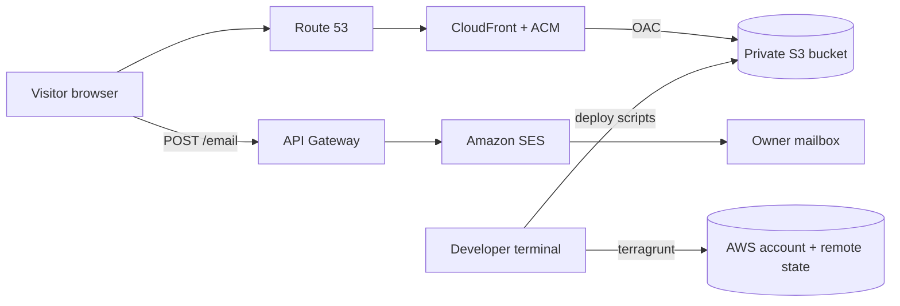

# System architecture

How the production system is put together and why. Resource-level detail is in the
[infrastructure docs](../technical/infrastructure.md) and the READMEs of the units.

## Overview

## Request paths

- **Reading the site**: the browser resolves `samuelsulo.it` in Route 53, reaches CloudFront
  over HTTPS and gets static files from a private S3 bucket. The bucket is not public:
  CloudFront is the only reader.
- **Content**: at startup the app fetches `/content/*.json` from the same distribution, with
  revalidation on every visit, so content changes show up without a rebuild.
- **Contact form**: the browser calls the API on `contact.samuelsulo.it`. API Gateway
  validates the body and calls SES directly, which sends the email to the owner. There is no
  Lambda and no database: nothing a visitor writes is stored by the site.

## Decisions

| Decision                                       | Reason                                                                                            |
| ---------------------------------------------- | ------------------------------------------------------------------------------------------------- |
| Static site on S3 and CloudFront               | No servers to run or patch, low cost, fast                                                        |
| Direct API Gateway to SES integration          | No compute to maintain and no storage of personal data, which keeps the privacy policy simple     |
| Content fetched at runtime, outside the bundle | Texts and certifications change without a release; the schema version protects against a mismatch |
| Deploys from the terminal, never from CI       | Production access stays with the owner, with the credentials of their own terminal                |
| One production environment, no staging account | Personal project; a `sandbox` copy exists for risky changes                                       |
| No analytics and no tracking                   | Nothing needs consent, so no cookie banner                                                        |

## Constraints

Production runs in the owner's own AWS account (the region is `eu-south-1`, Milan, for the
site and the API; the CloudFront certificate is created in `us-east-1` as CloudFront
requires). The site processes personal data only through the contact form, and only in transit.
